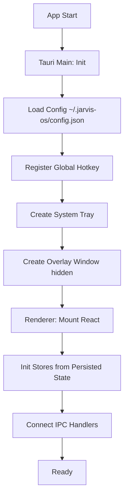
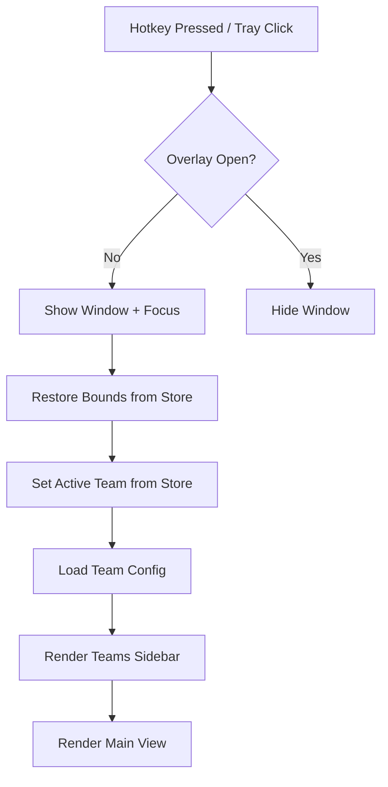
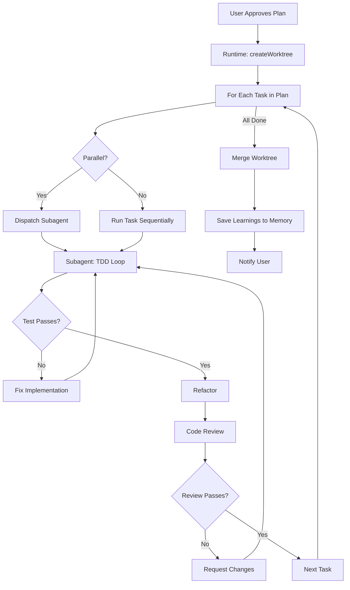

# JARVIS-OS — Architecture Document

**Version:** 0.1.0-draft
**Status:** Draft
**Author:** Matheus Chiodi (MCHIODI)

---

## 1. Visão Arquitetural

```
┌─────────────────────────────────────────────────────────────────────────────┐
│                              JARVIS-OS                                      │
│  ┌─────────────────────────────────────────────────────────────────────┐   │
│  │                        TAURI DESKTOP APP                            │   │
│  │  ┌──────────────┐  ┌────────────────────────────────────────────┐  │   │
│  │  │  MAIN (Rust) │  │           RENDERER (React)                 │  │   │
│  │  │              │  │  ┌──────────────────────────────────────┐  │  │   │
│  │  │ • System Tray│  │  │         OVERLAY WINDOW               │  │  │   │
│  │  │ • Global     │  │  │  ┌─────────┐ ┌────────────────────┐ │  │  │   │
│  │  │   Hotkey     │  │  │  │ Teams   │ │   Main View        │ │  │  │   │
│  │  │ • Window Mgmt│  │  │  │ Sidebar │ │  (Chat/Terminal/   │ │  │  │   │
│  │  │ • IPC Bridge │  │  │  │         │ │   Plan/Memory/     │ │  │  │   │
│  │  │ • Capabilities│ │  │  │         │ │   Settings)        │ │  │  │   │
│  │  └──────┬───────┘  │  │  └─────────┘ └────────────────────┘ │  │  │   │
│  │         │          │  │  ┌────────────────────────────────┐ │  │  │   │
│  │         │ IPC      │  │  │       STATUSLINE BAR           │ │  │  │   │
│  │         ▼          │  │  └────────────────────────────────┘ │  │  │   │
│  │  ┌──────────────┐  │  └──────────────────────────────────────┘  │  │   │
│  │  │  TAURI CORE  │  │                                          │  │   │
│  │  │  (Rust)      │  │                                          │  │   │
│  │  └──────────────┘  └──────────────────────────────────────────┘  │   │
│  └──────────────────────────────────────────────────────────────────┘   │
└─────────────────────────────────────────────────────────────────────────────┘
                                    │
                    ┌───────────────┼───────────────┐
                    ▼               ▼               ▼
            ┌─────────────┐ ┌─────────────┐ ┌─────────────┐
            │   MEMORY    │ │   RUNTIME   │ │   SKILLS    │
            │   LAYER     │ │   LAYER     │ │   LAYER     │
            │             │ │             │ │             │
            │ • Vault     │ │ • Teams     │ │ • Registry  │
            │ • Search    │ │ • Plans     │ │ • Loader    │
            │ • Hooks     │ │ • Worktrees │ │ • Built-ins │
            │ • Statusline│ │ • Subagents │ │ • Custom    │
            └─────────────┘ └─────────────┘ └─────────────┘
                    │               │               │
                    ▼               ▼               ▼
            ┌─────────────────────────────────────────────────┐
            │           SPECIALIZED CAPABILITIES              │
            │  ┌────────┐ ┌────────┐ ┌────────┐ ┌────────┐   │
            │  │ VOICE  │ │ VIDEO  │ │TRADING │ │ PIXEL  │   │
            │  │(Odisseu│ │(Hyper- │ │(Trading│ │(Pixel  │   │
            │  │Prompter│ │ frames)│ │Agents) │ │Agents) │   │
            │  │VoiceStu)│ │        │ │        │ │        │   │
            │  └────────┘ └────────┘ └────────┘ └────────┘   │
            └─────────────────────────────────────────────────┘
```

---

## 2. Decisões Arquiteturais (ADRs)

### ADR-001: Tauri v2 over Electron
**Status:** Accepted
**Context:** Precisamos de system tray, global hotkey, janela overlay sem decoração, IPC seguro.
**Decision:** Tauri v2 (Rust + WebView2/WebKitGTK)
**Consequences:**
- + Menor footprint (~50MB vs ~150MB Electron)
- + Rust para system-level ops (hotkey, tray, window management)
- + Segurança: capability-based IPC, CSP rigoroso
- - Curva de aprendizado Rust para team
- - WebView2 no Windows (já presente no Win10/11)

### ADR-002: Monorepo com pnpm Workspaces + Turborepo
**Status:** Accepted
**Context:** Múltiplos packages (core, memory, runtime, skills, voice, video, pixel, trading, ui-kit, apps)
**Decision:** pnpm workspaces + Turborepo para build/test caching
**Consequences:**
- + Instalação rápida, deduplicação de deps
- + Build incremental inteligente
- + Versionamento independente por package
- + Shared tooling (tsconfig, biome, vitest config)

### ADR-003: SQLite WASM (sql.js) + FTS5 para Vault
**Status:** Accepted
**Context:** Memory layer precisa rodar no renderer (browser context), zero native deps
**Decision:** sql.js (SQLite compilado para WASM) com extensão FTS5
**Consequences:**
- + Roda no renderer process, sem IPC para queries
- + Zero native dependencies
- + FTS5 nativo para full-text search
- - ~2MB WASM bundle
- - Performance ligeiramente menor que native

### ADR-004: Chroma WASM + @xenova/transformers para Vector Search
**Status:** Accepted
**Context:** Embeddings + vector search local, sem servidor separado
**Decision:** Chroma compilado para WASM + ONNX runtime via @xenova/transformers
**Consequences:**
- + Totalmente local, offline-capable
- + Embeddings via Xenova/all-MiniLM-L6-v2 (384 dim, 22MB)
- + HNSW index no WASM
- - Cold start embeddings ~500ms
- - Memória ~100MB para modelo + index

### ADR-005: Worker Threads para Agent Runtime
**Status:** Accepted
**Context:** Agents rodam código não-confiável (LLM output), precisam isolamento
**Decision:** Node.js worker_threads + child_process para CLI tools
**Consequences:**
- + Isolamento de memória/CPU por agent
- + Paralelismo real (multi-core)
- + Crash de um agent não derruba o overlay
- - Complexidade de comunicação (MessagePort)
- - SharedArrayBuffer requer COOP/COEP headers

### ADR-006: Git Worktrees para Isolamento de Features
**Status:** Accepted
**Context:** Múltiplos agents trabalhando em paralelo no mesmo repo
**Decision:** Um worktree por feature branch, limpeza automática no merge
**Consequences:**
- + Isolamento total de working directory
- + Git operations nativas (merge, rebase, diff)
- + Fácil rollback (delete worktree)
- - Disk space (multiple checkouts)
- - Precisa git 2.5+

### ADR-007: Skill Registry com Lazy Loading + Namespaces
**Status:** Accepted
**Context:** 350+ skills de múltiplas fontes (ECC, mattpocock, superpowers, custom)
**Decision:** Registry centralizado, lazy load por namespace (`ecc:`, `matt:`, `super:`, `custom:`)
**Consequences:**
- + Zero conflitos de nomes
- + Carregamento sob demanda
- + Hot reload de skills customizadas
- - Precisa resolver dependências entre skills

### ADR-008: Zustand + Immer para State Management
**Status:** Accepted
**Context:** Overlay React precisa state global (teams, overlay, memory, runtime)
**Decision:** Zustand (simples, não-opinionated) + Immer (imutabilidade ergonomica)
**Consequences:**
- + Boilerplate mínimo
- + TypeScript first-class
- + DevTools integration
- + Fácil testing (pure functions)

### ADR-009: Biome para Lint/Format
**Status:** Accepted
**Context:** Precisamos velocidade, zero config, TypeScript support
**Decision:** Biome (Rust-based, substitui ESLint + Prettier)
**Consequences:**
- + 10-100x mais rápido que ESLint
- + Config único para lint + format
- + LSP nativo para IDE
- - Menos rules que ESLint ecosystem
- - Migration effort para rules custom

---

## 3. Componentes Detalhados

### 3.1 Tauri Main Process (Rust)

```
apps/desktop/src/main/
├── main.rs                 # Entry point
├── system_tray.rs          # System tray icon + menu
├── global_hotkey.rs        # Global hotkey registration (tauri-plugin-global-hotkey)
├── window_manager.rs       # Overlay window lifecycle (create, show, hide, bounds)
├── ipc/
│   ├── memory.rs           # Memory API commands
│   ├── runtime.rs          # Runtime API commands
│   ├── skills.rs           # Skills API commands
│   ├── voice.rs            # Voice API commands
│   ├── video.rs            # Video API commands
│   └── pixel.rs            # Pixel API commands
├── capabilities.rs         # Tauri capability definitions
├── config.rs               # Config loading/saving (~/.jarvis-os/config.json)
└── state.rs                # AppState compartilhado (Arc<RwLock<...>>)
```

**Capability Matrix:**
| Capability | Permissions |
|------------|-------------|
| `memory:read` | Vault read, search, timeline |
| `memory:write` | Save notes, archive, tags |
| `runtime:teams` | CRUD teams, plans, tasks |
| `runtime:execute` | Create worktrees, dispatch agents |
| `skills:load` | Load skill manifests |
| `skills:execute` | Invoke skill entry points |
| `voice:control` | STT/TTS/wake word |
| `video:render` | HyperFrames render |
| `pixel:connect` | WebSocket to Pixel Agents server |
| `fs:project` | Read/write project directory |
| `fs:config` | Read/write ~/.jarvis-os/ |
| `shell:git` | Git operations (worktree, commit, push) |
| `shell:cli` | Claude Code, npx, bun commands |

### 3.2 Renderer Process (React)

```
apps/desktop/src/renderer/
├── main.tsx                    # React entry
├── App.tsx                     # Root component
├── providers/
│   ├── StoreProvider.tsx       # Zustand store
│   ├── IpcProvider.tsx         # Tauri IPC wrappers
│   └── ConfigProvider.tsx      # Config context
├── components/
│   ├── overlay/
│   │   ├── OverlayWindow.tsx   # Janela principal (frameless)
│   │   ├── TitleBar.tsx        # Drag handle + window controls
│   │   ├── TeamsSidebar.tsx    # Lista de times + ações
│   │   ├── MainView.tsx        # View switcher (chat/terminal/plan/memory/settings)
│   │   ├── Statusline.tsx      # Plan% | Ctx% | Cost | Mem
│   │   └── FloatingButton.tsx  # Botão flutuante (sempre visível)
│   ├── chat/
│   │   ├── ChatView.tsx        # Interface conversacional
│   │   ├── MessageList.tsx     # Mensagens (user/agent/tool)
│   │   ├── MessageInput.tsx    # Input com slash commands
│   │   └── AgentAvatar.tsx     # Avatar do agent ativo
│   ├── terminal/
│   │   ├── TerminalView.tsx    # xterm.js wrapper
│   │   └── TerminalTabs.tsx    # Múltiplos terminais
│   ├── plan/
│   │   ├── PlanView.tsx        # Kanban/List de tasks
│   │   ├── TaskCard.tsx        # Task com status, assignee, deps
│   │   └── PlanTimeline.tsx    # Gantt view
│   ├── memory/
│   │   ├── MemoryView.tsx      # Search + timeline + graph
│   │   ├── SearchPanel.tsx     # Progressive disclosure UI
│   │   ├── NoteEditor.tsx      # Markdown editor com frontmatter
│   │   └── GraphView.tsx       # Mermaid graph renderer
│   ├── settings/
│   │   ├── SettingsView.tsx    # Abas: General, Teams, Skills, Voice, Video, Pixel
│   │   ├── TeamEditor.tsx      # CRUD team + roles
│   │   └── SkillManager.tsx    # Enable/disable skills
│   └── ui/                     # shadcn/ui components
├── hooks/
│   ├── useOverlay.ts           # Overlay state + persistence
│   ├── useTeams.ts             # Teams CRUD + selection
│   ├── useMemory.ts            # Memory API wrapper
│   ├── useRuntime.ts           # Runtime API wrapper
│   ├── useSkills.ts            # Skills registry + invocation
│   ├── useVoice.ts             # Voice state + controls
│   └── useGlobalHotkey.ts      # Hotkey listener
├── stores/
│   ├── overlayStore.ts         # OverlayState (bounds, open, view, team)
│   ├── teamsStore.ts           # Teams[], activeTeamId
│   ├── memoryStore.ts          # Notes cache, search results
│   ├── runtimeStore.ts         # Plans, tasks, execution status
│   └── configStore.ts          # Config + persistence
├── styles/
│   ├── globals.css             # Tailwind + CSS vars
│   └── theme.css               # Dark/light theme tokens
└── utils/
    ├── ipc.ts                  # Typed IPC helpers
    ├── date.ts                 # Date formatting
    └── markdown.ts             # Frontmatter parsing
```

### 3.3 Memory Layer (packages/memory)

```
packages/memory/src/
├── index.ts                    # Exports públicos
├── vault/
│   ├── Vault.ts                # Vault class (SQLite + FTS5)
│   ├── Schema.ts               # SQL schema + migrations
│   ├── NoteRepository.ts       # CRUD notes
│   └── ProjectRepository.ts    # Project metadata
├── search/
│   ├── SearchEngine.ts         # FTS5 + Vector hybrid
│   ├── Fts5Index.ts            # FTS5 wrapper
│   ├── VectorIndex.ts          # Chroma WASM wrapper
│   ├── Embeddings.ts           # @xenova/transformers wrapper
│   └── ProgressiveDisclosure.ts # search/timeline/get_observations
├── hooks/
│   ├── TaskCompletedHook.ts    # Enforça nota no task complete
│   ├── TeammateIdleHook.ts     # Enforça nota no idle
│   └── HookRegistry.ts         # Registro de hooks
├── statusline/
│   ├── StatuslineCollector.ts  # Aggrega dados para statusline
│   └── StatuslineRenderer.ts   # Formata linha de status
├── graph/
│   ├── WikilinkExtractor.ts    # Extrai [[wikilinks]] do markdown
│   ├── GraphBuilder.ts         # Constrói grafo Mermaid
│   └── BacklinkIndex.ts        # Índice reverso
├── frontmatter/
│   ├── Parser.ts               # Parse/serialize YAML frontmatter
│   ├── Schema.ts               # Zod schema para validação
│   └── Canonicalizer.ts        # Ordem canônica de campos
└── types/
    ├── note.ts                 # Note, NoteFrontmatter, NoteType
    ├── search.ts               # SearchResult, SearchIndexItem, TimelineEvent
    └── vault.ts                # Vault, Project
```

**Vault Schema (SQLite):**
```sql
-- Projects
CREATE TABLE projects (
  id TEXT PRIMARY KEY,
  name TEXT NOT NULL,
  path TEXT NOT NULL UNIQUE,
  created_at TEXT NOT NULL,
  updated_at TEXT NOT NULL
);

-- Notes (FTS5 virtual table for full-text search)
CREATE VIRTUAL TABLE notes_fts USING fts5(
  id UNINDEXED,
  project_id UNINDEXED,
  type UNINDEXED,
  title,
  summary,
  content,
  tags,
  agent UNINDEXED,
  task_id UNINDEXED,
  created_at UNINDEXED,
  updated_at UNINDEXED,
  tokenize = 'porter unicode61'
);

-- Notes metadata (non-FTS)
CREATE TABLE notes (
  id TEXT PRIMARY KEY,
  project_id TEXT NOT NULL REFERENCES projects(id),
  type TEXT NOT NULL CHECK (type IN ('memory','decision','learning','communication','state')),
  title TEXT NOT NULL,
  summary TEXT NOT NULL,
  content TEXT NOT NULL,
  frontmatter_json TEXT NOT NULL,  -- Full frontmatter as JSON
  tags TEXT NOT NULL,              -- CSV
  agent TEXT NOT NULL,
  task_id TEXT,
  wikilinks TEXT NOT NULL,         -- CSV of [[links]]
  pinned INTEGER DEFAULT 0,
  archived INTEGER DEFAULT 0,
  created_at TEXT NOT NULL,
  updated_at TEXT NOT NULL,
  FOREIGN KEY (project_id) REFERENCES projects(id)
);

-- Vector embeddings (Chroma WASM manages this separately)
-- But we store mapping note_id -> chroma_id
CREATE TABLE note_embeddings (
  note_id TEXT PRIMARY KEY REFERENCES notes(id),
  chroma_id TEXT NOT NULL,
  model TEXT NOT NULL,
  created_at TEXT NOT NULL
);

-- Hooks state
CREATE TABLE hook_state (
  id TEXT PRIMARY KEY,             -- taskId or agentId
  type TEXT NOT NULL CHECK (type IN ('task_completed','teammate_idle')),
  project_id TEXT NOT NULL,
  last_note_id TEXT,
  updated_at TEXT NOT NULL
);

-- Indexes
CREATE INDEX idx_notes_project_type ON notes(project_id, type);
CREATE INDEX idx_notes_agent ON notes(agent);
CREATE INDEX idx_notes_task ON notes(task_id);
CREATE INDEX idx_notes_created ON notes(created_at);
```

### 3.4 Runtime Layer (packages/runtime)

```
packages/runtime/src/
├── index.ts
├── teams/
│   ├── TeamManager.ts            # CRUD teams
│   ├── TeamValidator.ts          # Validação de team config
│   └── TeamPersistence.ts        # Salva em ~/.jarvis-os/teams.json
├── planner/
│   ├── Planner.ts                # Orquestra brainstorming → plan
│   ├── BrainstormingSkill.ts     # Integração com skill grill-me
│   └── PlanGenerator.ts          # Gera Plan a partir de spec
├── executor/
│   ├── PlanExecutor.ts           # Executa plan (superpowers workflow)
│   ├── TaskRunner.ts             # Runs individual task
│   ├── WorktreeManager.ts        # Git worktree lifecycle
│   └── SubagentDispatcher.ts     # Parallel task dispatch
├── tdd/
│   ├── TddEnforcer.ts            # Red → Green → Refactor loop
│   ├── TestGenerator.ts          # Gera failing test
│   ├── ImplementationGenerator.ts # Gera implementation
│   └── RefactorAnalyzer.ts       # Sugere refactors
├── review/
│   ├── CodeReviewer.ts           # Two-phase review
│   ├── SpecComplianceReviewer.ts # Phase 1: spec compliance
│   ├── CodeQualityReviewer.ts    # Phase 2: code quality
│   └── ReviewAggregator.ts       # Combina reviews
├── verification/
│   ├── VerificationRunner.ts     # Roda testes + lint + typecheck
│   └── CompletionVerifier.ts     # Verification before completion
├── git/
│   ├── GitWorktree.ts            # Worktree operations
│   ├── GitBranch.ts              # Branch management
│   └── GitDiff.ts                # Diff utilities
└── types/
    ├── team.ts
    ├── plan.ts
    ├── task.ts
    └── execution.ts
```

### 3.5 Skills Layer (packages/skills)

```
packages/skills/src/
├── index.ts
├── registry/
│   ├── SkillRegistry.ts          # Central registry, lazy loading
│   ├── SkillLoader.ts            # Carrega skill de disco
│   ├── NamespaceResolver.ts      # ecc: matt: super: custom:
│   └── DependencyGraph.ts        # Resolve skill deps
├── builtin/
│   ├── ecc/                      # 314 skills (copiadas/submodule)
│   ├── mattpocock/               # 40+ skills
│   ├── superpowers/              # 15 skills
│   └── index.ts                  # Re-exports
├── custom/
│   ├── CustomSkillLoader.ts      # Carrega de ~/.jarvis-os/skills/custom/
│   └── SkillScaffold.ts          # Gera skill nova
├── invocation/
│   ├── UserInvoked.ts            # Slash command → skill
│   ├── ModelInvoked.ts           # Auto-trigger via triggers
│   └── SkillContext.ts           # Context passado para skill
└── types/
    ├── skill.ts
    └── context.ts
```

**Skill Manifest (skill.yaml):**
```yaml
id: "ecc:security-review"
name: "Security Review"
description: "OWASP Top 10 audit for code changes"
invocation: "model"  # user | model | both
triggers:
  - "security review"
  - "audit code"
  - "vulnerability scan"
entryPoint: "./skills/security-review/index.ts"
config:
  severity: "high"
  autoTriggerOn: ["PreToolUse:Write", "PreToolUse:Edit"]
dependencies:
  - "ecc:code-review"
  - "matt:diagnosing-bugs"
```

### 3.6 Voice Layer (packages/voice)

```
packages/voice/src/
├── index.ts
├── wake-word/
│   ├── PorcupineWrapper.ts       # Picovoice Porcupine (ou openWakeWord)
│   ├── WakeWordDetector.ts       # Interface unificada
│   └── Models/                   # .ppn files para "jarvis", "odisseu"
├── stt/
│   ├── WebSpeechSTT.ts           # Web Speech API (browser)
│   ├── WhisperCppSTT.ts          # whisper.cpp (local, via native node addon)
│   └── SttEngine.ts              # Interface + factory
├── tts/
│   ├── PiperTTS.ts               # sherpa-onnx + Piper pt-BR
│   ├── TtsEngine.ts              # Interface
│   └── Voices/                   # ONNX models (faber, cadu, jeff)
├── teleprompter/
│   ├── Tracker.ts                # Portado de prompter-mchiodi (tracker.ts)
│   ├── Normalizer.ts             # Phonetic key + aliases
│   └── MarkdownParser.ts         # Script parser
└── types/
    ├── stt.ts
    ├── tts.ts
    └── teleprompter.ts
```

### 3.7 Video Layer (packages/video)

```
packages/video/src/
├── index.ts
├── hyperframes/
│   ├── HyperFramesClient.ts      # Wrapper para HyperFrames CLI
│   ├── CompositionBuilder.ts     # Gera HTML composition
│   ├── CatalogClient.ts          # npx hyperframes add <block>
│   └── RenderJob.ts              # Render local / AWS Lambda
├── remotion/
│   ├── RemotionBridge.ts         # Import Remotion projects
│   └── CompositionConverter.ts   # Remotion → HyperFrames
├── frame-md/
│   ├── FrameMdParser.ts          # Parse frame.md
│   └── DesignTokenConverter.ts   # Design tokens → video tokens
└── types/
    ├── composition.ts
    └── render.ts
```

### 3.8 Pixel Layer (packages/pixel)

```
packages/pixel/src/
├── index.ts
├── client/
│   ├── PixelClient.ts            # WebSocket client para Pixel Agents server
│   ├── AgentTracker.ts           # Track agent states
│   └── LayoutSync.ts             # Sync office layout
├── visualizer/
│   ├── OfficeCanvas.tsx          # Canvas 2D renderer
│   ├── Character.tsx             # Pixel character sprite
│   ├── Furniture.tsx             # Furniture sprites
│   └── Pathfinding.ts            # A* pathfinding
└── types/
    ├── agent.ts
    ├── layout.ts
    └── events.ts
```

---

## 4. Fluxos de Dados

### 4.1 Inicialização do App


### 4.2 Abrir Overlay (Hotkey/Click)


### 4.3 Executar Plan (Superpowers Workflow)


### 4.4 Memory Search (Progressive Disclosure)
```mermaid
flowchart LR
    A[Agent Query] --> B[SearchEngine.searchIndex]
    B --> C[FTS5 Keyword Search]
    B --> D[Vector Similarity Search]
    C --> E[Merge + Rank]
    D --> E
    E --> F[Return SearchIndexItem[]]
    F --> G[Agent Selects IDs]
    G --> H[SearchEngine.getObservations]
    H --> I[Chroma Get by IDs]
    I --> J[Return ObservationDetail[]]
```

---

## 5. Segurança

### 5.1 Tauri Capability Model
```json
// tauri.conf.json capabilities
{
  "capabilities": [
    {
      "identifier": "memory-read",
      "description": "Read memory vault",
      "permissions": ["core:event:listen", "op:fs:read", "op:sql:execute"],
      "windows": ["overlay"]
    },
    {
      "identifier": "runtime-execute",
      "description": "Execute agent plans",
      "permissions": [
        "core:shell:allow",
        "op:shell:command:git",
        "op:shell:command:claude",
        "op:shell:command:npx"
      ],
      "windows": ["overlay"]
    }
  ]
}
```

### 5.2 Isolamento de Processos
```
┌─────────────────────────────────────────────────────────────┐
│                      TAURI MAIN (Rust)                      │
│  - System Tray, Hotkey, Window Management                   │
│  - Capability Enforcement                                   │
│  - IPC Router                                               │
└─────────────────────┬───────────────────────────────────────┘
                      │ IPC (Tauri)
                      ▼
┌─────────────────────────────────────────────────────────────┐
│                    RENDERER (WebView)                       │
│  ┌─────────────┐  ┌─────────────┐  ┌─────────────────────┐  │
│  │   Overlay   │  │   Memory    │  │    Runtime          │  │
│  │   UI        │  │   Layer     │  │    (Main Thread)    │  │
│  └─────────────┘  └──────┬──────┘  └──────────┬──────────┘  │
└─────────────────────────┼──────────────────────┼────────────┘
                          │                      │
              ┌───────────┴───────────┐  ┌──────┴──────┐
              ▼                       ▼  ▼             ▼
       ┌─────────────┐         ┌─────────────┐ ┌─────────────┐
       │  Worker     │         │  Worker     │ │  Worker     │
       │  Thread     │         │  Thread     │ │  Thread     │
       │  (Agent 1)  │         │  (Agent 2)  │ │  (Agent N)  │
       └─────────────┘         └─────────────┘ └─────────────┘
```

### 5.3 Data Flow Security
- **API Keys**: Apenas em environment variables / OS Keychain (nunca no vault)
- **Private Tags**: `<private>...</private>` no conteúdo → stripped antes de indexar
- **Network**: `tauri-plugin-http` com allowlist apenas para LLM providers configurados
- **File System**: Scoped to project directory + `~/.jarvis-os/`

---

## 6. Performance

### 6.1 Budgets
| Métrica | Budget | Measurement |
|---------|--------|-------------|
| App cold start | < 3s | Tauri + React mount |
| Overlay show (hot) | < 200ms | Window show + render |
| Memory search (10k notes) | < 100ms p95 | FTS5 + Vector |
| Vector embedding (single) | < 100ms | ONNX inference |
| Worktree create | < 2s | Git worktree add |
| TDD cycle (red→green) | < 30s | Test + impl + verify |

### 6.2 Otimizações
- **Lazy loading**: Skills, Voice, Video, Pixel carregados sob demanda
- **Virtual scrolling**: Lists de notes, tasks, search results
- **Debounced IPC**: Batched statusline updates (100ms)
- **WASM caching**: SQLite/Chroma WASM cached via Service Worker
- **Bundle splitting**: Vite code splitting por route/view

---

## 7. Observabilidade

### 7.1 Logging
- **Structured logging**: `tracing` (Rust) + `pino` (TypeScript)
- **Levels**: error, warn, info, debug, trace
- **Output**: File (`~/.jarvis-os/logs/`) + Console (dev)

### 7.2 Metrics (Prometheus-compatible)
```typescript
// Exported via /metrics endpoint (dev only)
- jarvis_overlay_open_total
- jarvis_plan_executed_total
- jarvis_task_duration_seconds
- jarvis_memory_search_duration_seconds
- jarvis_memory_notes_total
- jarvis_agent_active_count
- jarvis_errors_total
```

### 7.3 Tracing
- **OpenTelemetry** integration (opcional)
- **Spans**: IPC calls, skill execution, git operations, LLM calls

---

## 8. Deployment

### 8.1 Build Pipeline
```yaml
# .github/workflows/build.yml
- Matrix: windows-latest, macos-latest, ubuntu-latest
- Steps:
  1. Setup Rust + Node + pnpm
  2. pnpm install --frozen-lockfile
  3. pnpm turbo run build
  4. pnpm turbo run test
  5. Tauri build (per platform)
  6. Sign/Notarize (macOS/Windows)
  7. Create GitHub Release + artifacts
```

### 8.2 Distribution
| Platform | Format | Channel |
|----------|--------|---------|
| Windows | `.msi` + `.exe` | GitHub Releases, Winget |
| macOS | `.dmg` (universal) | GitHub Releases, Homebrew |
| Linux | `.AppImage` + `.deb` | GitHub Releases, Flatpak |

### 8.3 Auto-Update
- **Tauri Updater** com GitHub Releases
- **Signature verification** (cosign/sigstore)
- **Delta updates** (bsdiff)
- **Channel**: stable / beta / nightly

---

## 9. Test Strategy

### 9.1 Unit Tests (Vitest)
- **Coverage target**: > 80% para core packages
- **Focus**: Pure functions (parsers, validators, calculators)
- **Memory layer**: Real SQLite WASM em temp dir
- **Runtime**: Mocked IPC, test doubles para git/LLM

### 9.2 Integration Tests (Vitest + Testcontainers)
- **Tauri IPC**: Test commands end-to-end
- **Git worktrees**: Real git repo em temp dir
- **Skills**: Load + invoke built-in skills

### 9.3 E2E Tests (Playwright)
- **Overlay**: Open/close, hotkey, drag, resize
- **Teams**: CRUD, switch, persist
- **Plan execution**: Full workflow mock LLM
- **Memory**: Search, create notes, graph
- **Cross-platform**: Win/Mac/Linux via CI

### 9.4 Contract Tests
- **IPC schemas**: Zod schemas validated both sides
- **Skill manifests**: Schema validation on load
- **Config migration**: Version upgrade tests

---

## 10. Migração e Compatibilidade

### 10.1 Config Migration
```typescript
// packages/core/src/config/migration.ts
const migrations: Record<number, (config: any) => any> = {
  1: (c) => ({ ...c, version: 2, voice: { enabled: false } }),
  2: (c) => ({ ...c, version: 3, video: { enabled: false } }),
  // ...
};
```

### 10.2 Vault Migration
- Schema versionado na tabela `projects`
- Migração automática no `Vault.open()`
- Backup automático antes de migrar

### 10.3 Skill Compatibility
- Semantic versioning por skill
- `minAppVersion` / `maxAppVersion` no manifest
- Fallback gracioso se skill incompatível

---

## 11. Referências Cruzadas

| Documento | Link |
|-----------|------|
| Technical Spec | `docs/TECHNICAL_SPEC.md` |
| ADRs | `docs/adr/*.md` |
| API Types | `packages/core/src/types/index.ts` |
| Tauri Config | `apps/desktop/tauri.conf.json` |
| Package Config | `pnpm-workspace.yaml`, `turbo.json` |

---

## 12. Glossário

| Termo | Definição |
|-------|-----------|
| **Overlay** | Janela principal flutuante estilo Claude Code |
| **Team** | Grupo de agents com roles definidas, working directory compartilhado |
| **Vault** | Obsidian-compatible vault por projeto (SQLite + Markdown) |
| **Worktree** | Git worktree isolado para feature branch |
| **Skill** | Unidade de comportamento reutilizável (user-invoked ou model-invoked) |
| **Progressive Disclosure** | Busca em 3 camadas: index → timeline → full observations |
| **Statusline** | Barra inferior com plan%, ctx%, cost, memory status |
| **Subagent** | Agent efêmero para tarefa paralela |
| **Frame.md** | Design system invertido para vídeo (HyperFrames) |