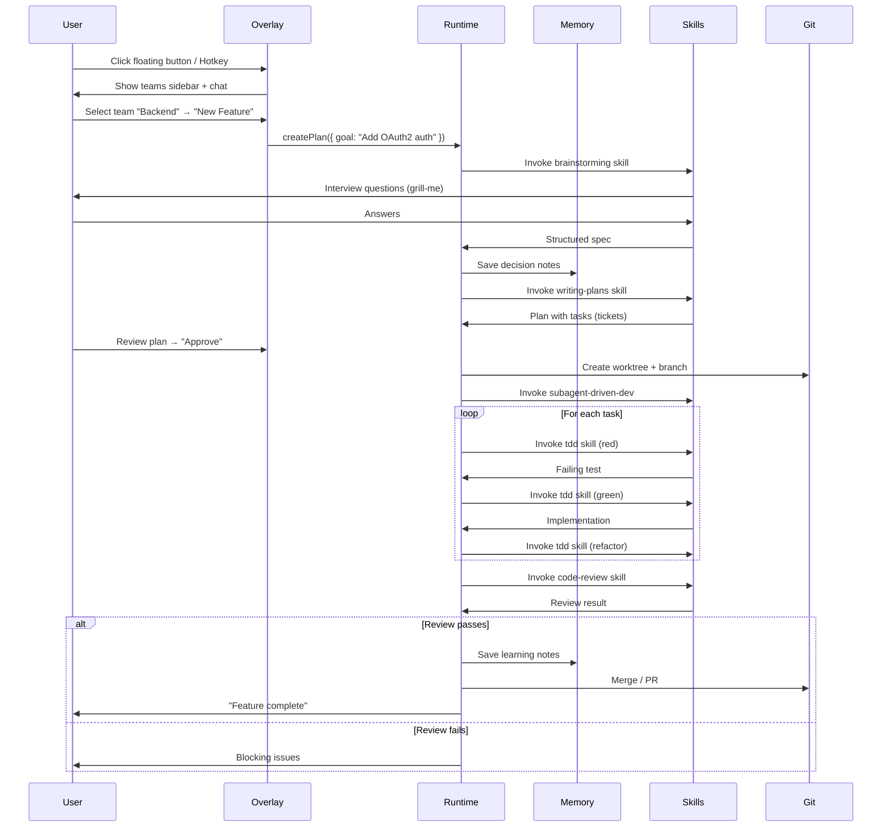
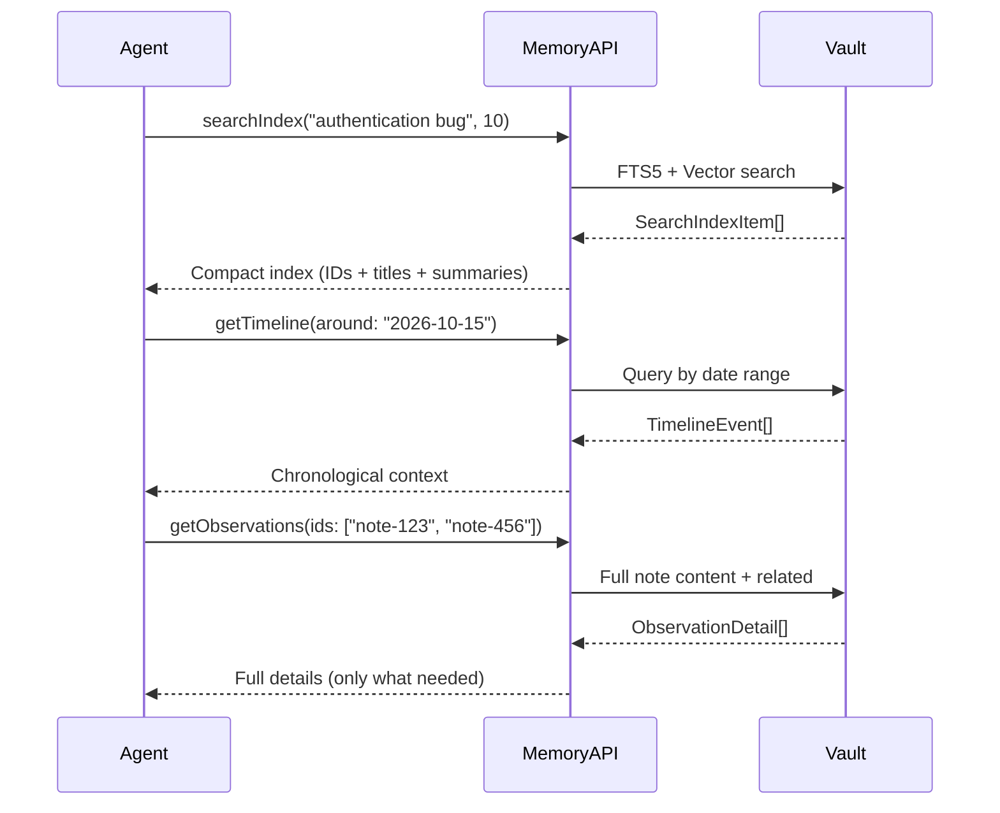

# JARVIS-OS — Technical Specification

**Version:** 0.1.0-draft
**Status:** Draft
**Author:** Matheus Chiodi (MCHIODI)

---

## 1. Visão Geral

JARVIS-OS é um **sistema operacional de agentes** que roda localmente na máquina do desenvolvedor. Ele fornece:

- Um **botão flutuante global** (hotkey `Win+Alt+J` / `Cmd+Shift+J`) sempre acessível
- Ao clicar, abre um **overlay estilo Claude Code** para gerenciar **múltiplos times de agentes**
- **Memória persistente** por projeto (Obsidian vault + SQLite + Vector search)
- **Workflow obrigatório** (Superpowers): brainstorming → plan → TDD → review → verify
- **Skills compostas** (ECC + mattpocock/skills + superpowers): 350+ skills disponíveis
- **Camadas especializadas**: Voice, Video, Trading, Pixel UI

---

## 2. Requisitos Funcionais

### 2.1 Floating Button & Overlay
| ID | Requisito | Prioridade |
|----|-----------|------------|
| FR-01 | Botão flutuante sempre visível (top-right, draggable) | P0 |
| FR-02 | Hotkey global `Win+Alt+J` / `Cmd+Shift+J` abre/fecha overlay | P0 |
| FR-03 | Overlay estilo Claude Code: sidebar teams + área principal chat/terminal | P0 |
| FR-04 | Overlay não rouba foco do app ativo (click-through quando fechado) | P0 |
| FR-05 | Persiste posição/tamanho do overlay entre sessões | P1 |

### 2.2 Team Management
| ID | Requisito | Prioridade |
|----|-----------|------------|
| FR-10 | Criar/editar/deletar times de agentes | P0 |
| FR-11 | Cada time tem: nome, agentes (roles), working directory, skills habilitadas | P0 |
| FR-12 | Agents por time: planner, architect, coder, reviewer, tester, researcher, docs | P0 |
| FR-13 | Sub-agent teams (ephemeral) para tarefas paralelas | P1 |
| FR-14 | Persistir configuração de times em `~/.jarvis-os/teams.json` | P0 |

### 2.3 Memory Layer
| ID | Requisito | Prioridade |
|----|-----------|------------|
| FR-20 | Vault Obsidian por projeto em `~/.jarvis-os/memory/<project>/` | P0 |
| FR-21 | Notas tipadas: `memory`, `decision`, `learning`, `communication`, `state` | P0 |
| FR-22 | Wikilinks `[[...]]` + frontmatter YAML canônico | P0 |
| FR-23 | Busca híbrida: FTS5 (keyword) + Chroma (vector) | P0 |
| FR-24 | Progressive disclosure: search → timeline → get_observations | P0 |
| FR-25 | Hooks `TaskCompleted` / `TeammateIdle` enforçam nota antes de fechar | P1 |
| FR-26 | Statusline em tempo real no overlay: plan%, ctx%, cost, mem status | P1 |

### 2.4 Agent Runtime (Superpowers Workflow)
| ID | Requisito | Prioridade |
|----|-----------|------------|
| FR-30 | Workflow obrigatório: brainstorming → writing-plans → subagent-driven-dev → TDD → code-review → finish | P0 |
| FR-31 | Git worktrees isolados por feature branch | P0 |
| FR-32 | TDD enforcement: red → green → refactor (delete code written before tests) | P0 |
| FR-33 | Code review em duas fases: spec compliance → code quality | P0 |
| FR-34 | Subagent dispatch para tarefas independentes | P1 |
| FR-35 | Verification before completion: roda testes/lint antes de declarar done | P0 |

### 2.5 Skills System
| ID | Requisito | Prioridade |
|----|-----------|------------|
| FR-40 | Carregar skills de: ECC (314), mattpocock/skills (40+), superpowers (15), custom | P0 |
| FR-41 | Skills user-invoked (slash commands) e model-invoked (auto-trigger) | P0 |
| FR-42 | Skill registry com lazy loading | P0 |
| FR-43 | Skills customizadas em `~/.jarvis-os/skills/custom/` | P1 |

### 2.6 Voice Layer (Opcional)
| ID | Requisito | Prioridade |
|----|-----------|------------|
| FR-50 | Wake word "Jarvis" / "Odisseu" ativa listening | P1 |
| FR-51 | STT: Web Speech API + Silero VAD (browser) ou Whisper.cpp (local) | P1 |
| FR-52 | TTS offline: Piper pt-BR (faber/cadu/jeff) via sherpa-onnx | P1 |
| FR-53 | Teleprompter mode: segue voz palavra a palavra (Prompter-MChiodi) | P2 |
| FR-54 | Voice cloning / design (VoiceStudio) para persona do Jarvis | P2 |

### 2.7 Video Layer (Opcional)
| ID | Requisito | Prioridade |
|----|-----------|------------|
| FR-60 | Gerar vídeos via HyperFrames (HTML → MP4 determinístico) | P1 |
| FR-61 | Catalog de 450+ blocks: transitions, charts, 3D, captions | P1 |
| FR-62 | Remotion compat: importar projetos Remotion existentes | P2 |
| FR-63 | Frame.md: inverter design system para vídeo | P2 |

### 2.8 Pixel Agents Visualizer (Opcional)
| ID | Requisito | Prioridade |
|----|-----------|------------|
| FR-70 | Mostrar agentes como chars pixel-art em escritório | P2 |
| FR-71 | Animação baseada em atividade real (typing, reading, waiting) | P2 |
| FR-72 | Speech bubbles quando agent aguarda input | P2 |
| FR-73 | Layout editor persistente | P2 |

---

## 3. Requisitos Não-Funcionais

| ID | Requisito | Target |
|----|-----------|--------|
| NFR-01 | **Local-first**: zero dados saem da máquina (exceto LLM provider escolhido) | Hard |
| NFR-02 | **Startup frio** < 3s (overlay abre) | P0 |
| NFR-03 | **Memória** < 200MB RAM base (sem agents rodando) | P0 |
| NFR-04 | **Cross-platform**: Windows 10/11, macOS 13+, Linux (AppImage/Flatpak) | P0 |
| NFR-05 | **Offline-capable**: Voice/Video/Memory funcionam sem internet | P0 |
| NFR-06 | **Privacidade**: `<private>` tags excluem conteúdo sensível do storage | P0 |
| NFR-07 | **Extensibilidade**: Plugin API para novas camadas (Trading, etc.) | P1 |
| NFR-08 | **Acessibilidade**: WCAG 2.1 AA no overlay | P1 |

---

## 4. Stack Tecnológico

| Camada | Tecnologia | Justificativa |
|--------|------------|---------------|
| **Desktop Shell** | Tauri v2 (Rust + WebView) | Menor footprint que Electron, Rust para system tray/global hotkey |
| **Overlay UI** | React 19 + TypeScript + Tailwind CSS + shadcn/ui | Consistente com ecossistema, acessível |
| **State Management** | Zustand + Immer | Simples, imutável, TypeScript-first |
| **Memory Vault** | SQLite (sql.js WASM) + FTS5 + Chroma (WASM) | Zero native deps, roda no renderer |
| **Vector Search** | @xenova/transformers (ONNX) + HNSW | Embeddings locais, sem servidor |
| **Agent Runtime** | Node.js worker_threads + child_process | Isolamento, paralelismo |
| **Git Operations** | simple-git + native git worktree | Confiável, bem testado |
| **Testing** | Vitest (unit) + Playwright (e2e) | Fast, moderno, browser automation |
| **Lint/Format** | Biome (rust-based) | Velocidade, zero config |
| **Package Manager** | pnpm (workspaces) | Monorepo, disk efficient |
| **Build** | Vite + Tauri CLI | Fast HMR, optimized production |

---

## 5. Estrutura do Projeto (Monorepo)

```
jarvis-os/
├── apps/
│   ├── desktop/           # Tauri app (floating button + overlay)
│   │   ├── src/
│   │   │   ├── main/      # Rust: system tray, global hotkey, window management
│   │   │   └── renderer/  # React: overlay UI
│   │   ├── tauri.conf.json
│   │   └── package.json
│   └── cli/               # CLI opcional para automação headless
├── packages/
│   ├── core/              # Types, constants, shared utilities
│   ├── memory/            # Memory layer (vault, search, hooks)
│   ├── runtime/           # Agent runtime (superpowers workflow)
│   ├── skills/            # Skills registry, loader, built-in skills
│   ├── voice/             # Voice layer (STT/TTS/wake word)
│   ├── video/             # Video layer (HyperFrames integration)
│   ├── pixel/             # Pixel Agents visualizer integration
│   ├── trading/           # TradingAgents integration (optional)
│   └── ui-kit/            # Shared UI components (shadcn-based)
├── tools/
│   ├── build-scripts/     # Scripts de build customizados
│   └── test-utils/        # Test helpers, fixtures
├── docs/
│   ├── TECHNICAL_SPEC.md  # Este arquivo
│   ├── ARCHITECTURE.md
│   └── adr/               # Architecture Decision Records
├── turbo.json             # Turborepo config
├── pnpm-workspace.yaml
├── package.json
├── tsconfig.base.json
├── biome.json
└── README.md
```

---

## 6. Contratos de Dados (Core Types)

```typescript
// packages/core/src/types/index.ts

// === TEAMS ===
interface AgentRole {
  id: string;
  name: string;
  type: 'planner' | 'architect' | 'coder' | 'reviewer' | 'tester' | 'researcher' | 'docs' | 'custom';
  skills: string[];           // skill IDs habilitados para este role
  model?: string;             // override de modelo (ex: 'opus', 'sonnet', 'haiku')
  systemPrompt?: string;      // prompt adicional
}

interface Team {
  id: string;
  name: string;
  description?: string;
  workingDir: string;         // caminho absoluto
  roles: AgentRole[];
  enabledSkills: string[];    // skills globais do time
  createdAt: string;          // ISO 8601
  updatedAt: string;
}

// === MEMORY ===
type NoteType = 'memory' | 'decision' | 'learning' | 'communication' | 'state';

interface NoteFrontmatter {
  id: string;
  type: NoteType;
  title: string;
  summary: string;
  tags: string[];
  agent: string;
  taskId?: string;
  project: string;
  createdAt: string;          // ISO 8601
  updatedAt: string;
  wikilinks: string[];        // [[note-title]]
  pinned: boolean;
  archived: boolean;
}

interface Note {
  frontmatter: NoteFrontmatter;
  content: string;            // Markdown body
  path: string;               // vault-relative path
}

interface SearchResult {
  note: Note;
  score: number;
  matches: { field: string; snippet: string }[];
}

// Progressive disclosure layers
interface SearchIndexItem {
  id: string;
  title: string;
  summary: string;
  type: NoteType;
  agent: string;
  tags: string[];
  createdAt: string;
}

interface TimelineEvent {
  timestamp: string;
  notes: SearchIndexItem[];
}

interface ObservationDetail extends Note {
  // Full detail for get_observations
  relatedNotes: SearchIndexItem[];
}

// === AGENT RUNTIME ===
interface Task {
  id: string;
  teamId: string;
  title: string;
  description: string;
  status: 'pending' | 'in_progress' | 'review' | 'done' | 'blocked';
  assigneeRole: string;
  dependencies: string[];     // task IDs
  worktreePath?: string;      // git worktree path
  createdAt: string;
  updatedAt: string;
  completedAt?: string;
}

interface Plan {
  id: string;
  teamId: string;
  goal: string;
  tasks: Task[];
  status: 'draft' | 'approved' | 'executing' | 'completed';
  createdAt: string;
  updatedAt: string;
}

// === SKILLS ===
interface Skill {
  id: string;
  name: string;
  description: string;
  invocation: 'user' | 'model' | 'both';
  triggers?: string[];        // para model-invoked
  entryPoint: string;         // path to skill implementation
  config?: Record<string, unknown>;
}

interface SkillContext {
  team: Team;
  projectRoot: string;
  memory: MemoryAPI;
  runtime: RuntimeAPI;
  ui: UIAPI;
}

// === OVERLAY STATE ===
interface OverlayState {
  isOpen: boolean;
  bounds: { x: number; y: number; width: number; height: number };
  activeTeamId?: string;
  activeView: 'chat' | 'terminal' | 'plan' | 'memory' | 'settings';
  sidebarCollapsed: boolean;
}
```

---

## 7. APIs Internas (Memory / Runtime / UI)

### 7.1 MemoryAPI
```typescript
interface MemoryAPI {
  // Vault management
  getVault(projectId: string): Promise<Vault>;
  createVault(projectId: string, path: string): Promise<Vault>;
  
  // Notes CRUD
  saveNote(note: Omit<Note, 'path'>): Promise<Note>;
  getNote(projectId: string, ref: string): Promise<Note | null>;
  listNotes(projectId: string, filters?: NoteFilters): Promise<Note[]>;
  archiveNote(projectId: string, ref: string): Promise<void>;
  deleteNote(projectId: string, ref: string): Promise<void>;
  
  // Search (progressive disclosure)
  searchIndex(projectId: string, query: string, limit?: number): Promise<SearchIndexItem[]>;
  getTimeline(projectId: string, around?: string, windowDays?: number): Promise<TimelineEvent[]>;
  getObservations(projectId: string, ids: string[]): Promise<ObservationDetail[]>;
  
  // Graph
  getBacklinks(projectId: string, ref: string): Promise<Note[]>;
  getGraph(projectId: string): Promise<MermaidGraph>;
  
  // Hooks
  onTaskCompleted(taskId: string, agentId: string): Promise<void>;
  onTeammateIdle(agentId: string): Promise<void>;
  
  // Statusline
  getStatuslineData(projectId: string): Promise<StatuslineData>;
}
```

### 7.2 RuntimeAPI
```typescript
interface RuntimeAPI {
  // Team management
  createTeam(team: Omit<Team, 'id' | 'createdAt' | 'updatedAt'>): Promise<Team>;
  getTeam(id: string): Promise<Team | null>;
  listTeams(): Promise<Team[]>;
  updateTeam(id: string, patch: Partial<Team>): Promise<Team>;
  deleteTeam(id: string): Promise<void>;
  
  // Plan/Task execution
  createPlan(plan: Omit<Plan, 'id' | 'createdAt' | 'updatedAt'>): Promise<Plan>;
  executePlan(planId: string, options?: ExecuteOptions): Promise<ExecutionResult>;
  getPlanStatus(planId: string): Promise<PlanStatus>;
  
  // Git worktrees
  createWorktree(teamId: string, branchName: string): Promise<string>; // returns path
  removeWorktree(path: string): Promise<void>;
  
  // Subagent dispatch
  dispatchSubagents(tasks: Task[]): Promise<SubagentResult[]>;
  
  // Code review
  requestCodeReview(planId: string, targetBranch: string): Promise<ReviewResult>;
  
  // Verification
  verifyCompletion(planId: string): Promise<VerificationResult>;
}
```

### 7.3 UIAPI
```typescript
interface UIAPI {
  // Overlay control
  openOverlay(): Promise<void>;
  closeOverlay(): Promise<void>;
  toggleOverlay(): Promise<void>;
  setOverlayBounds(bounds: OverlayBounds): Promise<void>;
  
  // Views
  setActiveView(view: OverlayState['activeView']): Promise<void>;
  setActiveTeam(teamId: string): Promise<void>;
  
  // Notifications
  notify(title: string, body: string, level?: 'info' | 'warning' | 'error'): Promise<void>;
  showToast(message: string, duration?: number): Promise<void>;
  
  // Statusline
  updateStatusline(data: StatuslineData): Promise<void>;
}
```

---

## 8. Fluxos Principais

### 8.1 Fluxo: Nova Feature (Happy Path)


### 8.2 Fluxo: Memory Search (Progressive Disclosure)


---

## 9. Configuração

### 9.1 Variáveis de Ambiente
```bash
# LLM Providers (pelo menos um necessário)
ANTHROPIC_API_KEY=sk-ant-...
OPENAI_API_KEY=sk-...
GOOGLE_API_KEY=...
OLLAMA_BASE_URL=http://localhost:11434

# JARVIS-OS Config
JARVIS_DATA_DIR=~/.jarvis-os          # Padrão: ~/.jarvis-os
JARVIS_HOTKEY=Win+Alt+J               # Override hotkey
JARVIS_LOG_LEVEL=info                 # debug|info|warn|error
JARVIS_AUTO_UPDATE=true               # Auto-update check

# Voice (opcional)
JARVIS_WAKE_WORD=jarvis               # ou "odisseu"
JARVIS_TTS_VOICE=faber                # faber|cadu|jeff
JARVIS_STT_ENGINE=web-speech          # web-speech|whisper-cpp

# Video (opcional)
JARVIS_VIDEO_ENGINE=hyperframes       # hyperframes|remotion
```

### 9.2 Arquivo de Configuração (`~/.jarvis-os/config.json`)
```json
{
  "version": 1,
  "hotkey": "Win+Alt+J",
  "overlay": {
    "defaultBounds": { "x": 100, "y": 100, "width": 1200, "height": 800 },
    "theme": "system",
    "animations": true
  },
  "memory": {
    "vaultPath": "~/.jarvis-os/memory",
    "vectorSearch": true,
    "embeddingModel": "Xenova/all-MiniLM-L6-v2",
    "hooks": {
      "taskCompleted": true,
      "teammateIdle": true
    }
  },
  "teams": [],
  "skills": {
    "enabled": ["core", "superpowers", "ecc", "mattpocock"],
    "customPath": "~/.jarvis-os/skills/custom"
  },
  "voice": {
    "enabled": false,
    "wakeWord": "jarvis",
    "ttsVoice": "faber",
    "sttEngine": "web-speech"
  },
  "video": {
    "enabled": false,
    "engine": "hyperframes"
  },
  "pixel": {
    "enabled": false,
    "port": 3100
  }
}
```

---

## 10. Segurança

| Aspecto | Implementação |
|---------|---------------|
| **Isolamento** | Cada team roda em worktree git separado; agents em worker_threads |
| **Permissões** | Tauri capability system: só expõe APIs necessárias ao renderer |
| **Secrets** | API keys apenas em env vars / OS keychain; nunca no vault |
| **Private Data** | Tags `<private>` no conteúdo → excluído de search/index |
| **Network** | Zero outbound exceto LLM provider configurado; telemetria opt-out |
| **Updates** | Verificação de assinatura (cosign/sigstore) antes de aplicar |

---

## 11. Métricas de Sucesso (KPIs)

| Métrica | Target |
|---------|--------|
| Cold start (button → overlay ready) | < 3s |
| Memory search (10k notes) | < 100ms p95 |
| Plan → first test (TDD) | < 30s |
| Agent task throughput | > 5 tasks/min |
| Memory retention across sessions | 100% |
| Test coverage (core packages) | > 80% |
| Zero critical CVEs | Continuous |

---

## 12. Roadmap

### Phase 0: Foundation (Weeks 1-2)
- [ ] Scaffold monorepo + Tauri app
- [ ] Floating button + global hotkey
- [ ] Basic overlay (React + shadcn/ui)
- [ ] Config system + persistence

### Phase 1: Memory Layer (Weeks 3-4)
- [ ] Vault implementation (SQLite + FTS5)
- [ ] Vector search (Chroma WASM + transformers)
- [ ] Note CRUD + wikilinks + frontmatter
- [ ] Progressive disclosure API (search/timeline/get)
- [ ] Statusline integration

### Phase 2: Agent Runtime (Weeks 5-7)
- [ ] Team management CRUD
- [ ] Superpowers workflow engine
- [ ] Git worktree automation
- [ ] TDD enforcement loop
- [ ] Code review pipeline
- [ ] Subagent dispatch

### Phase 3: Skills System (Weeks 8-9)
- [ ] Skill registry + lazy loading
- [ ] Port ECC skills (314)
- [ ] Port mattpocock skills (40+)
- [ ] Port superpowers skills (15)
- [ ] Custom skill authoring

### Phase 4: Polish + Voice (Weeks 10-12)
- [ ] Floating button polish (animations, drag)
- [ ] Overlay UX refinements
- [ ] Voice layer integration (Odisseu/Prompter)
- [ ] Wake word + STT/TTS
- [ ] Accessibility audit

### Phase 5: Video + Pixel (Weeks 13-14)
- [ ] HyperFrames integration
- [ ] Video generation skill
- [ ] Pixel Agents visualizer
- [ ] Frame.md support

### Phase 6: Trading + Advanced (Week 15+)
- [ ] TradingAgents integration
- [ ] Plugin API for custom layers
- [ ] Multi-machine sync (optional)
- [ ] Performance optimization

---

## 13. Riscos e Mitigações

| Risco | Probabilidade | Impacto | Mitigação |
|-------|---------------|---------|-----------|
| Tauri v2 instabilidade | Média | Alto | Pin version, test matrix Win/Mac/Linux |
| Vector search performance | Média | Médio | Benchmark early, fallback to keyword-only |
| Skill conflicts (ECC vs mattpocock) | Alta | Médio | Namespace isolation, prefix-based routing |
| Memory bloat over time | Média | Alto | Archival policy, compaction, size limits |
| Global hotkey conflicts | Baixa | Médio | Configurable hotkey, conflict detection |
| LLM provider rate limits | Alta | Médio | Budget tracking, fallback providers, local Ollama |

---

## 14. Referências

- [Odisseu Assistant Architecture](https://github.com/MatheusChiodi/odisseu-assistant/blob/main/docs/en/03-arquitetura.md)
- [Cockpit Mods Catalog](https://github.com/MatheusChiodi/cockpit/blob/main/README.md)
- [AgentTeam-Memory Spec](https://github.com/MatheusChiodi/AgentTeam-Memory/blob/main/docs/ARCHITECTURE.md)
- [Claude-Mem Architecture](https://docs.claude-mem.ai/architecture/overview)
- [Superpowers Methodology](https://github.com/obra/superpowers/blob/main/README.md)
- [ECC Universal](https://github.com/affaan-m/ECC/blob/main/README.md)
- [HyperFrames](https://hyperframes.heygen.com/introduction)
- [VoiceStudio](https://github.com/debpalash/VoiceStudio)
- [Pixel Agents](https://github.com/pixel-agents-hq/pixel-agents)
- [TradingAgents](https://github.com/TauricResearch/TradingAgents)
- [Remotion Video](https://github.com/MatheusChiodi/remotion-video)
- [Prompter MChiodi](https://github.com/MatheusChiodi/prompter-mchiodi)
- [Matt Pocock Skills](https://github.com/mattpocock/skills)