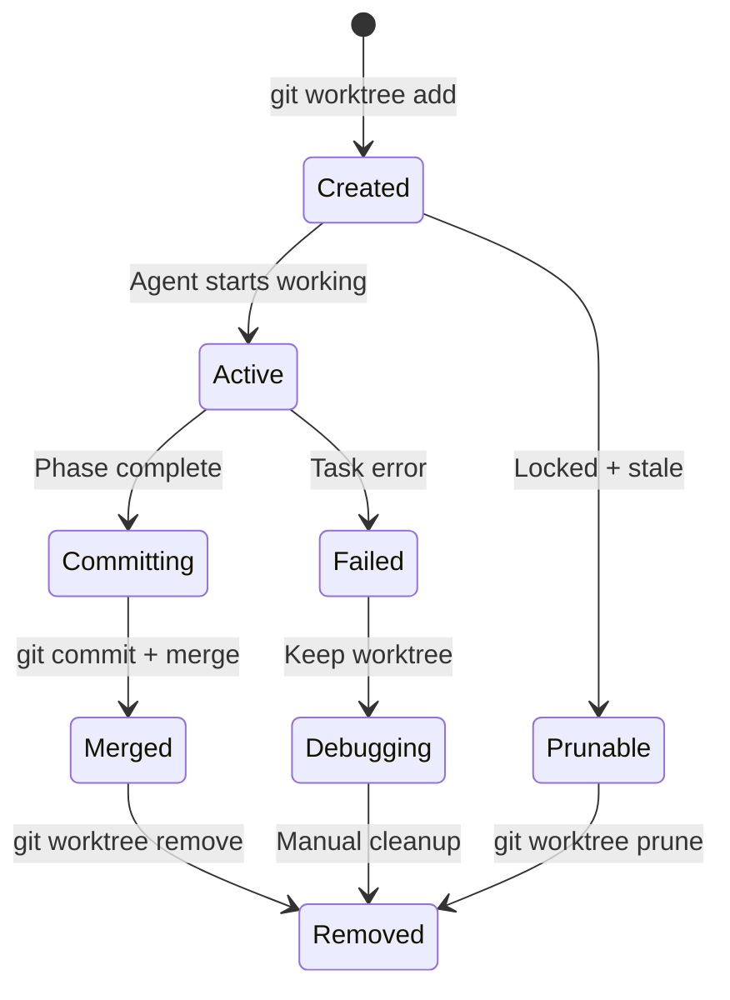

# ADR-006: Git Worktrees for Feature Isolation

**Date:** 2026-10-31
**Status:** Accepted
**Author:** Matheus Chiodi

## Context

Múltiplos agents trabalhando em paralelo no mesmo repositório:
- Precisam isolamento total de working directory
- Cada feature branch deve ser independente
- Fácil merge/cleanup após conclusão
- Git operations nativas (diff, merge, rebase, stash)
- Compatível com qualquer Git host (GitHub, GitLab, local)

## Decision

Usar **Git Worktrees** (`git worktree add`) para isolamento de features.
Um worktree por feature branch, criado no início do plan, removido no merge/cleanup.

## Alternatives Considered

| Option | Pros | Cons |
|--------|------|------|
| **Git Worktrees** | **Nativo, isolamento total, mesmo .git, operações Git padrão, leve** | **Requer Git 2.5+, disk space (múltiplos checkouts)** |
| **Separate clones** | Isolamento total, simples | Muito disk space, sync manual, lento |
| **Git branches + stash** | Sem disk extra | Conflitos frequentes, stash limitado, não isolado |
| **Docker volumes** | Isolamento forte | Overhead container, complexo, lento |
| **Tmpfs + symlinks** | Rápido, RAM | Volátil, complexo, Linux-only |
| **Copy-on-write (btrfs/zfs)** | Eficiente | FS-specific, não portável |

## Consequences

### Positive
- **Isolamento total**: Cada worktree tem seu próprio working directory, index, HEAD
- **Mesmo .git**: Objetos compartilhados, disk eficiente (~50MB base + diffs)
- **Git nativo**: `git diff`, `git merge`, `git rebase`, `git stash` funcionam normalmente
- **Paralelismo**: Múltiplos agents em worktrees diferentes = zero conflitos
- **Cleanup simples**: `git worktree remove` + `git branch -d`
- **Portável**: Funciona em qualquer Git host, qualquer OS

### Negative
- **Disk space**: Cada worktree = checkout completo (~100-500MB por projeto médio)
- **Git version**: Requer Git 2.5+ (2015) - universal hoje
- **Locked worktrees**: Se crash, pode ficar `.git/worktrees/xxx/locked` - precisa cleanup manual
- **Submodules**: Worktrees com submodules precisam cuidado extra
- **IDE integration**: VS Code precisa reabrir workspace no worktree path

## Implementation

```typescript
// packages/runtime/src/git/WorktreeManager.ts
import { simpleGit, SimpleGit, SimpleGitOptions } from 'simple-git';
import { mkdtemp, rm, readdir } from 'fs/promises';
import { join } from 'path';
import { tmpdir } from 'os';

export interface WorktreeInfo {
  path: string;
  branch: string;
  commit: string;
  locked: boolean;
  prunable: boolean;
}

export class WorktreeManager {
  private git: SimpleGit;
  private baseWorktreeDir: string;
  private projectRoot: string;

  constructor(projectRoot: string) {
    this.projectRoot = projectRoot;
    this.git = simpleGit(projectRoot);
    this.baseWorktreeDir = join(tmpdir(), 'jarvis-worktrees', this.hashPath(projectRoot));
  }

  async init(): Promise<void> {
    // Ensure base dir exists
    await this.git.status(); // Validates git repo
  }

  async createWorktree(branchName: string, baseBranch = 'main'): Promise<WorktreeInfo> {
    const worktreePath = join(this.baseWorktreeDir, branchName);
    
    // Create branch if not exists
    const branches = await this.git.branchLocal();
    if (!branches.all.includes(branchName)) {
      await this.git.checkoutLocalBranch(branchName, baseBranch);
    } else {
      await this.git.checkout(branchName);
    }

    // Add worktree
    await this.git.addWorktree(worktreePath, branchName);

    // Verify
    const worktrees = await this.listWorktrees();
    const wt = worktrees.find(w => w.path === worktreePath);
    if (!wt) throw new Error(`Worktree not created: ${worktreePath}`);

    return wt;
  }

  async removeWorktree(branchName: string, force = false): Promise<void> {
    const worktrees = await this.listWorktrees();
    const wt = worktrees.find(w => w.branch === branchName);
    
    if (!wt) return; // Already removed

    try {
      await this.git.removeWorktree(wt.path, { force });
    } catch (error) {
      if (force) {
        // Force remove: delete directory + prune
        await rm(wt.path, { recursive: true, force: true });
        await this.git.worktreePrune();
      } else {
        throw error;
      }
    }

    // Delete branch if merged
    const merged = await this.isBranchMerged(branchName);
    if (merged) {
      await this.git.deleteLocalBranch(branchName);
    }
  }

  async listWorktrees(): Promise<WorktreeInfo[]> {
    const output = await this.git.raw(['worktree', 'list', '--porcelain']);
    return this.parseWorktreeList(output);
  }

  async getWorktreePath(branchName: string): Promise<string | null> {
    const worktrees = await this.listWorktrees();
    return worktrees.find(w => w.branch === branchName)?.path || null;
  }

  async isBranchMerged(branchName: string): Promise<boolean> {
    try {
      const merged = await this.git.raw(['branch', '--merged', 'main']);
      return merged.split('\n').some(l => l.trim() === branchName || l.trim() === `* ${branchName}`);
    } catch {
      return false;
    }
  }

  async cleanupPrunable(): Promise<number> {
    const worktrees = await this.listWorktrees();
    let removed = 0;
    
    for (const wt of worktrees) {
      if (wt.prunable && wt.locked === false) {
        await this.removeWorktree(wt.branch, true);
        removed++;
      }
    }
    
    return removed;
  }

  private parseWorktreeList(output: string): WorktreeInfo[] {
    const worktrees: WorktreeInfo[] = [];
    let current: Partial<WorktreeInfo> = {};
    
    for (const line of output.split('\n')) {
      if (line.startsWith('worktree ')) {
        if (current.path) worktrees.push(current as WorktreeInfo);
        current = { path: line.slice(9).trim() };
      } else if (line.startsWith('HEAD ')) {
        current.commit = line.slice(5).trim();
      } else if (line.startsWith('branch ')) {
        current.branch = line.slice(7).trim().replace('refs/heads/', '');
      } else if (line === 'locked') {
        current.locked = true;
      } else if (line === 'prunable') {
        current.prunable = true;
      }
    }
    if (current.path) worktrees.push(current as WorktreeInfo);
    
    return worktrees;
  }

  private hashPath(path: string): string {
    // Simple hash for directory name
    let hash = 0;
    for (let i = 0; i < path.length; i++) {
      hash = ((hash << 5) - hash) + path.charCodeAt(i);
      hash |= 0;
    }
    return Math.abs(hash).toString(36);
  }
}
```

```typescript
// packages/runtime/src/executor/PlanExecutor.ts
import { WorktreeManager } from '../git/WorktreeManager';
import { WorkerPool } from './WorkerPool';

export class PlanExecutor {
  private worktreeManager: WorktreeManager;
  private workerPool: WorkerPool;
  private plan: Plan;

  constructor(plan: Plan, projectRoot: string) {
    this.plan = plan;
    this.worktreeManager = new WorktreeManager(projectRoot);
    this.workerPool = new WorkerPool();
  }

  async execute(): Promise<ExecutionResult> {
    const results: TaskResult[] = [];
    
    for (const phase of this.plan.phases) {
      // Create worktree for this phase
      const branchName = `jarvis/${this.plan.id}/${phase.id}`;
      const worktree = await this.worktreeManager.createWorktree(branchName);
      
      try {
        // Execute tasks in phase (parallel if independent)
        const phaseResults = await this.executePhase(phase, worktree.path);
        results.push(...phaseResults);
        
        // Commit phase changes
        await this.commitPhase(worktree.path, phase.id);
        
      } finally {
        // Cleanup worktree (keep if failed for debugging)
        const allPassed = phaseResults.every(r => r.success);
        if (allPassed) {
          await this.worktreeManager.removeWorktree(branchName);
        } else {
          // Keep worktree for debugging, mark for cleanup
          await this.markWorktreeForDebug(worktree.path, phase.id);
        }
      }
    }

    // Final merge to main
    if (results.every(r => r.success)) {
      await this.mergeToMain();
    }

    return { planId: this.plan.id, results, success: results.every(r => r.success) };
  }

  private async executePhase(phase: PlanPhase, worktreePath: string): Promise<TaskResult[]> {
    const tasks = phase.tasks;
    
    // Build dependency graph
    const dag = this.buildTaskDag(tasks);
    
    // Execute in topological order, parallel where possible
    const results: TaskResult[] = [];
    const completed = new Set<string>();
    
    while (completed.size < tasks.length) {
      // Find ready tasks (all deps completed)
      const ready = tasks.filter(t => 
        !completed.has(t.id) && 
        t.dependencies.every(d => completed.has(d))
      );

      if (ready.length === 0) {
        throw new Error('Circular dependency detected');
      }

      // Dispatch ready tasks in parallel
      const taskPromises = ready.map(task => 
        this.workerPool.execute({
          id: task.id,
          type: task.type,
          payload: task,
          context: {
            ...this.baseContext,
            worktreePath,
            taskId: task.id,
          }
        })
      );

      const taskResults = await Promise.all(taskPromises);
      
      for (const result of taskResults) {
        results.push(result);
        completed.add(result.taskId);
        
        if (!result.success) {
          // Stop on first failure (configurable)
          throw new Error(`Task ${result.taskId} failed: ${result.error}`);
        }
      }
    }

    return results;
  }

  private async commitPhase(worktreePath: string, phaseId: string): Promise<void> {
    const git = simpleGit(worktreePath);
    await git.add('.');
    await git.commit(`jarvis: phase ${phaseId} completed\n\nPlan: ${this.plan.id}\nPhase: ${phaseId}`);
  }

  private async mergeToMain(): Promise<void> {
    // Merge all phase branches to main via PR or direct merge
    // Implementation depends on git host
  }
}
```

## Worktree Lifecycle



## Disk Space Management

```typescript
// packages/runtime/src/git/DiskManager.ts
export class DiskManager {
  private static readonly MAX_WORKTREES = 10;
  private static readonly MAX_TOTAL_SIZE_GB = 10;

  static async checkSpace(worktreeManager: WorktreeManager): Promise<SpaceStatus> {
    const worktrees = await worktreeManager.listWorktrees();
    let totalSize = 0;

    for (const wt of worktrees) {
      totalSize += await this.getDirSize(wt.path);
    }

    return {
      worktreeCount: worktrees.length,
      totalSizeBytes: totalSize,
      maxWorktrees: this.MAX_WORKTREES,
      maxSizeBytes: this.MAX_TOTAL_SIZE_GB * 1024 ** 3,
      canCreate: worktrees.length < this.MAX_WORKTREES && totalSize < this.MAX_TOTAL_SIZE_GB * 1024 ** 3,
    };
  }

  static async enforceLimits(worktreeManager: WorktreeManager): Promise<void> {
    const status = await this.checkSpace(worktreeManager);
    
    if (!status.canCreate) {
      // Remove oldest prunable worktrees
      await worktreeManager.cleanupPrunable();
      
      // If still over limit, force remove oldest
      const worktrees = await worktreeManager.listWorktrees();
      worktrees
        .sort((a, b) => new Date(a.commit).getTime() - new Date(b.commit).getTime())
        .slice(0, worktrees.length - this.MAX_WORKTREES + 1)
        .forEach(wt => worktreeManager.removeWorktree(wt.branch, true));
    }
  }
}
```

## References

- [Git Worktree Documentation](https://git-scm.com/docs/git-worktree)
- [Git Worktree Tutorial](https://www.atlassian.com/git/tutorials/git-worktree)
- [simple-git worktree API](https://github.com/steveukx/git-js/blob/main/docs/simple-git.md#worktree)