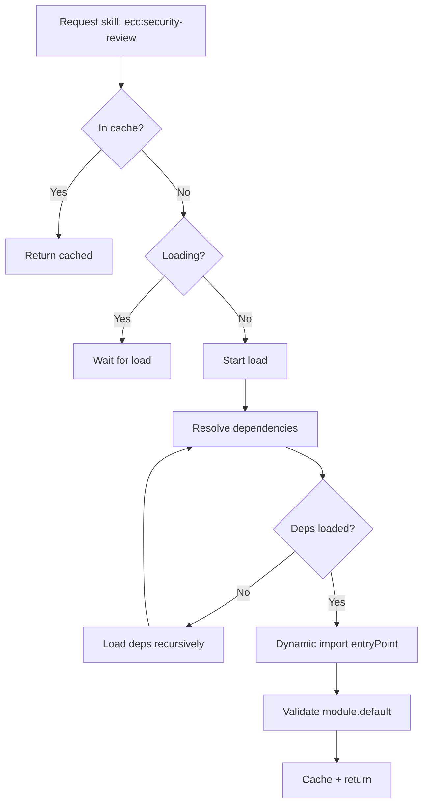

# ADR-007: Skill Registry with Lazy Loading + Namespaces

**Date:** 2026-10-31
**Status:** Accepted
**Author:** Matheus Chiodi

## Context

JARVIS-OS integra skills de múltiplas fontes:
- **ECC**: 314 skills (agent-harness-os)
- **mattpocock/skills**: 40+ skills (engineering + productivity)
- **superpowers**: 15 skills (methodology)
- **Custom**: User-created skills

Total: **350+ skills** com possíveis conflitos de nomes, dependências cruzadas, diferentes formatos.

## Decision

Implementar **Skill Registry centralizado** com:
- **Namespaces obrigatórios**: `ecc:`, `matt:`, `super:`, `custom:`
- **Lazy loading**: Carrega skill só quando invocada
- **Dependency resolution**: Grafo de deps com detecção de ciclos
- **Hot reload**: Skills customizadas recarregam sem restart
- **Schema validation**: Zod schema para manifest + entry point

## Alternatives Considered

| Option | Pros | Cons |
|--------|------|------|
| **Namespace + Lazy Load** | **Zero conflitos, carregamento sob demanda, hot reload, escalável** | **Complexidade de registry, resolution de deps** |
| **Flat registry (no namespace)** | Simples | Conflitos de nomes inevitáveis (ex: `tdd` em 3 fontes) |
| **Eager load all** | Simples, pronto imediato | Memory bloat (~350 skills), startup lento |
| **Single source only** | Zero conflitos | Perde funcionalidades das outras fontes |
| **Monkey-patch merge** | Unifica APIs | Frágil, breaking changes, debug difícil |

## Consequences

### Positive
- **Zero name conflicts**: `ecc:tdd` vs `matt:tdd` vs `super:tdd-workflow`
- **Lazy loading**: Startup rápido, memória só para skills usadas
- **Hot reload**: `custom:` skills em `~/.jarvis-os/skills/custom/` recarregam via `fs.watch`
- **Dependency graph**: Resolve ordem de carregamento, detecta ciclos
- **Versioning**: Cada skill com `package.json` próprio, semver
- **Isolation**: Skills custom não afetam built-ins

### Negative
- **Registry complexity**: Código extra para loader, resolver, cache
- **First invocation latency**: Primeira chamada carrega skill (mitigado com preload)
- **Dependency hell**: Skills podem depender de versões conflitantes de deps
- **Debugging**: Stack traces atravessam registry → skill

## Implementation

```typescript
// packages/skills/src/registry/SkillRegistry.ts
import { EventEmitter } from 'events';
import { watch, FSWatcher } from 'chokidar';
import { resolve, dirname } from 'path';
import { fileURLToPath } from 'url';

export const SKILL_NAMESPACES = ['ecc', 'matt', 'super', 'custom'] as const;
export type SkillNamespace = typeof SKILL_NAMESPACES[number];

export interface SkillManifest {
  id: string;                    // namespace:name (ex: ecc:security-review)
  name: string;                  // display name
  description: string;
  namespace: SkillNamespace;
  version: string;
  invocation: 'user' | 'model' | 'both';
  triggers?: string[];           // for model-invoked
  entryPoint: string;            // relative to skill root
  config?: Record<string, any>;
  dependencies?: string[];       // skill IDs
  minAppVersion?: string;
  maxAppVersion?: string;
  author?: string;
  license?: string;
}

export interface LoadedSkill {
  manifest: SkillManifest;
  module: SkillModule;
  loadedAt: Date;
}

export interface SkillModule {
  default: SkillEntryPoint;
  config?: any;
}

export type SkillEntryPoint = (context: SkillContext) => Promise<SkillResult>;

export interface SkillContext {
  team: Team;
  projectRoot: string;
  memory: MemoryAPI;
  runtime: RuntimeAPI;
  ui: UIAPI;
  skillConfig: Record<string, any>;
}

export interface SkillResult {
  success: boolean;
  output?: any;
  error?: string;
  artifacts?: SkillArtifact[];
}

export class SkillRegistry extends EventEmitter {
  private skills = new Map<string, LoadedSkill>();
  private manifests = new Map<string, SkillManifest>();
  private dependencyGraph = new Map<string, Set<string>>();
  private watchers: FSWatcher[] = [];
  private loading = new Map<string, Promise<LoadedSkill>>();

  constructor(private options: RegistryOptions) {
    this.loadBuiltinManifests();
    this.watchCustomSkills();
  }

  private loadBuiltinManifests(): void {
    // Load from built-in packages
    const builtinPaths = [
      { namespace: 'ecc', path: resolve(__dirname, '../../../builtin/ecc') },
      { namespace: 'matt', path: resolve(__dirname, '../../../builtin/mattpocock') },
      { namespace: 'super', path: resolve(__dirname, '../../../builtin/superpowers') },
    ];

    for (const { namespace, path } of builtinPaths) {
      this.scanManifests(namespace, path);
    }
  }

  private scanManifests(namespace: SkillNamespace, rootPath: string): void {
    // Walk skills directory, read skill.yaml/package.json
    // Implementation uses fast-glob
  }

  private watchCustomSkills(): void {
    const customPath = this.options.customSkillsPath;
    const watcher = watch(customPath, {
      ignored: /node_modules|\.git/,
      persistent: true,
    });

    watcher.on('add', (path) => this.onCustomSkillChange(path, 'add'));
    watcher.on('change', (path) => this.onCustomSkillChange(path, 'change'));
    watcher.on('unlink', (path) => this.onCustomSkillChange(path, 'unlink'));

    this.watchers.push(watcher);
  }

  private async onCustomSkillChange(path: string, event: string): Promise<void> {
    if (!path.endsWith('skill.yaml') && !path.endsWith('package.json')) return;
    
    const skillDir = dirname(path);
    const skillName = skillDir.split('/').pop()!;
    const skillId = `custom:${skillName}`;

    if (event === 'unlink') {
      this.unloadSkill(skillId);
    } else {
      await this.reloadSkill(skillId, skillDir);
    }
  }

  // Public API
  async getSkill(skillId: string): Promise<LoadedSkill> {
    // Check cache
    const cached = this.skills.get(skillId);
    if (cached) return cached;

    // Check if loading
    const loading = this.loading.get(skillId);
    if (loading) return loading;

    // Load
    const promise = this.loadSkill(skillId);
    this.loading.set(skillId, promise);
    
    try {
      const skill = await promise;
      this.loading.delete(skillId);
      return skill;
    } catch (error) {
      this.loading.delete(skillId);
      throw error;
    }
  }

  private async loadSkill(skillId: string): Promise<LoadedSkill> {
    const manifest = this.manifests.get(skillId);
    if (!manifest) throw new Error(`Skill not found: ${skillId}`);

    // Resolve dependencies first
    if (manifest.dependencies) {
      await Promise.all(manifest.dependencies.map(dep => this.getSkill(dep)));
    }

    // Dynamic import
    const module = await import(manifest.entryPoint);
    
    const loaded: LoadedSkill = {
      manifest,
      module,
      loadedAt: new Date(),
    };

    this.skills.set(skillId, loaded);
    this.emit('loaded', skillId);
    
    return loaded;
  }

  async invokeSkill(skillId: string, context: SkillContext): Promise<SkillResult> {
    const skill = await this.getSkill(skillId);
    const entryPoint = skill.module.default;
    
    if (!entryPoint) {
      throw new Error(`Skill ${skillId} has no default export`);
    }

    const start = Date.now();
    try {
      const result = await entryPoint(context);
      this.emit('invoked', { skillId, duration: Date.now() - start, success: true });
      return result;
    } catch (error) {
      this.emit('invoked', { skillId, duration: Date.now() - start, success: false, error });
      throw error;
    }
  }

  // Model-invoked: auto-trigger based on triggers
  findMatchingSkills(input: string): SkillManifest[] {
    const matches: SkillManifest[] = [];
    
    for (const manifest of this.manifests.values()) {
      if (manifest.invocation === 'model' || manifest.invocation === 'both') {
        if (manifest.triggers?.some(t => input.toLowerCase().includes(t.toLowerCase()))) {
          matches.push(manifest);
        }
      }
    }
    
    return matches.sort((a, b) => 
      (b.triggers?.length || 0) - (a.triggers?.length || 0)
    );
  }

  // Dependency resolution
  getLoadOrder(skillIds: string[]): string[] {
    const visited = new Set<string>();
    const visiting = new Set<string>();
    const order: string[] = [];

    const visit = (id: string) => {
      if (visited.has(id)) return;
      if (visiting.has(id)) throw new Error(`Circular dependency: ${id}`);
      
      visiting.add(id);
      const deps = this.dependencyGraph.get(id) || new Set();
      for (const dep of deps) visit(dep);
      visiting.delete(id);
      visited.add(id);
      order.push(id);
    };

    for (const id of skillIds) visit(id);
    return order;
  }

  // Custom skill authoring
  async scaffoldCustomSkill(name: string, template: 'basic' | 'tdd' | 'review' = 'basic'): Promise<string> {
    const skillId = `custom:${name}`;
    const skillDir = resolve(this.options.customSkillsPath, name);
    
    // Create directory structure
    await fs.mkdir(skillDir, { recursive: true });
    
    // Generate manifest
    const manifest: SkillManifest = {
      id: skillId,
      name,
      description: `Custom skill: ${name}`,
      namespace: 'custom',
      version: '0.1.0',
      invocation: 'both',
      entryPoint: './index.ts',
      dependencies: [],
    };
    
    await fs.writeFile(resolve(skillDir, 'skill.yaml'), yaml.dump(manifest));
    
    // Generate entry point from template
    const templatePath = resolve(__dirname, `../../templates/skill-${template}.ts`);
    await fs.copyFile(templatePath, resolve(skillDir, 'index.ts'));
    
    // Generate package.json
    await fs.writeFile(resolve(skillDir, 'package.json'), JSON.stringify({
      name: `@jarvis-os/skill-${name}`,
      version: '0.1.0',
      type: 'module',
      main: 'index.ts',
    }, null, 2));
    
    return skillDir;
  }

  // Cleanup
  async shutdown(): Promise<void> {
    for (const watcher of this.watchers) await watcher.close();
    this.skills.clear();
    this.manifests.clear();
  }
}
```

```yaml
# Example: packages/skills/builtin/ecc/security-review/skill.yaml
id: "ecc:security-review"
name: "Security Review"
description: "OWASP Top 10 audit for code changes"
namespace: "ecc"
version: "2.1.0"
invocation: "model"
triggers:
  - "security review"
  - "audit code"
  - "vulnerability scan"
  - "OWASP"
entryPoint: "./index.ts"
config:
  severity: "high"
  autoTriggerOn:
    - "PreToolUse:Write"
    - "PreToolUse:Edit"
dependencies:
  - "ecc:code-review"
  - "matt:diagnosing-bugs"
```

```typescript
// packages/skills/builtin/ecc/security-review/index.ts
import type { SkillEntryPoint, SkillContext, SkillResult } from '../../registry/SkillRegistry';

export const default: SkillEntryPoint = async (context: SkillContext): Promise<SkillResult> => {
  const { runtime, memory, skillConfig } = context;
  
  // Get current changes
  const diff = await runtime.getUncommittedDiff();
  
  // Run security analysis
  const findings = await analyzeSecurity(diff, skillConfig);
  
  // Save to memory
  await memory.saveNote({
    type: 'learning',
    title: 'Security Review Findings',
    summary: `${findings.length} issues found`,
    tags: ['security', 'review', 'auto'],
    agent: 'security-reviewer',
    content: formatFindings(findings),
  });

  return {
    success: true,
    output: { findings, count: findings.length },
  };
};

async function analyzeSecurity(diff: string, config: any): Promise<Finding[]> {
  // Implementation uses OWASP rules, static analysis, etc.
  return [];
}
```

## Skill Resolution Algorithm



## Preload Strategy

```typescript
// packages/skills/src/registry/PreloadStrategy.ts
export class PreloadStrategy {
  private registry: SkillRegistry;

  constructor(registry: SkillRegistry) {
    this.registry = registry;
  }

  // Preload on app start (background)
  async preloadCore(): Promise<void> {
    const coreSkills = [
      'ecc:tdd-workflow',
      'ecc:code-review',
      'ecc:security-review',
      'matt:grill-me',
      'matt:tdd',
      'super:brainstorming',
      'super:writing-plans',
      'super:test-driven-development',
    ];

    await Promise.allSettled(
      coreSkills.map(id => this.registry.getSkill(id))
    );
  }

  // Preload on team select
  async preloadForTeam(team: Team): Promise<void> {
    const skillIds = team.enabledSkills;
    await Promise.allSettled(
      skillIds.map(id => this.registry.getSkill(id))
    );
  }

  // Preload on user typing (slash command prefix)
  async preloadOnPrefix(prefix: string): Promise<void> {
    const matches = Array.from(this.registry.manifests.values())
      .filter(m => m.name.toLowerCase().startsWith(prefix.toLowerCase()))
      .slice(0, 5);
    
    await Promise.allSettled(
      matches.map(m => this.registry.getSkill(m.id))
    );
  }
}
```

## References

- [ECC Skills](https://github.com/affaan-m/ECC/tree/main/skills)
- [Matt Pocock Skills](https://github.com/mattpocock/skills)
- [Superpowers Skills](https://github.com/obra/superpowers/tree/main/skills)
- [Dynamic Import](https://developer.mozilla.org/en-US/docs/Web/JavaScript/Reference/Statements/import#dynamic_imports)